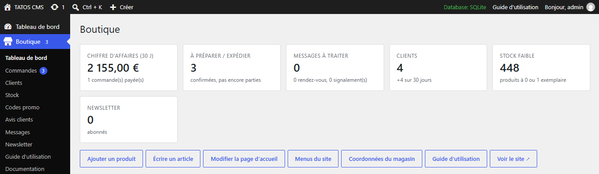
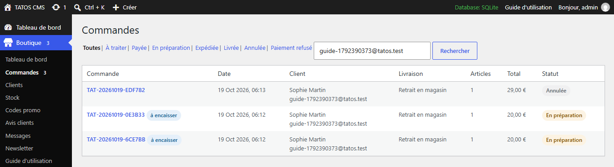
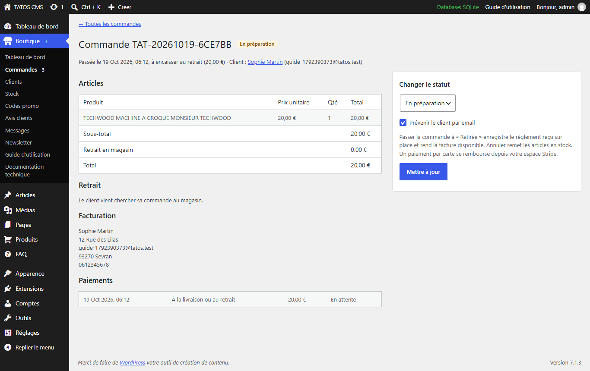
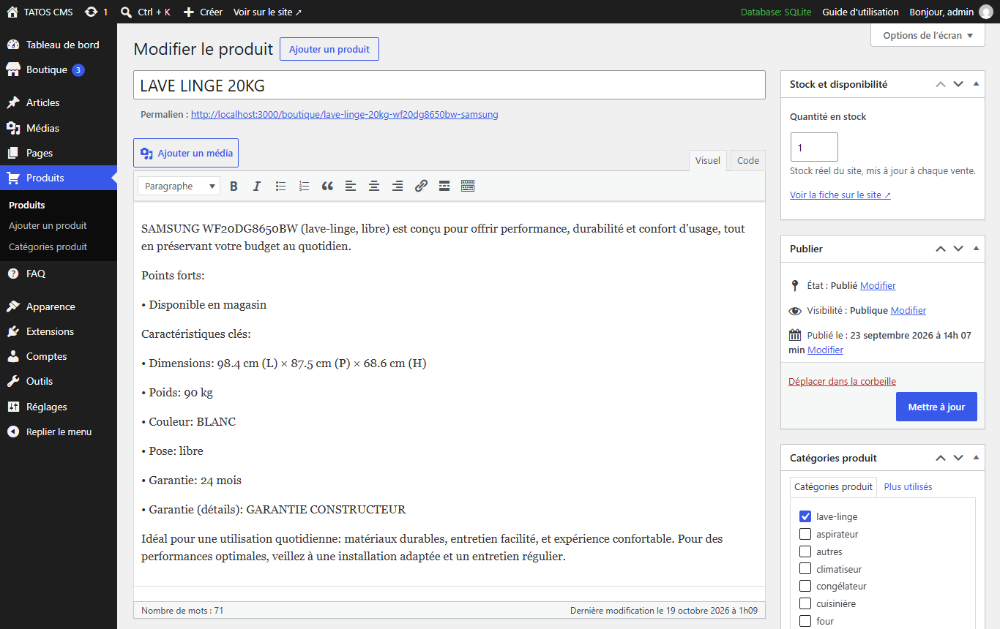
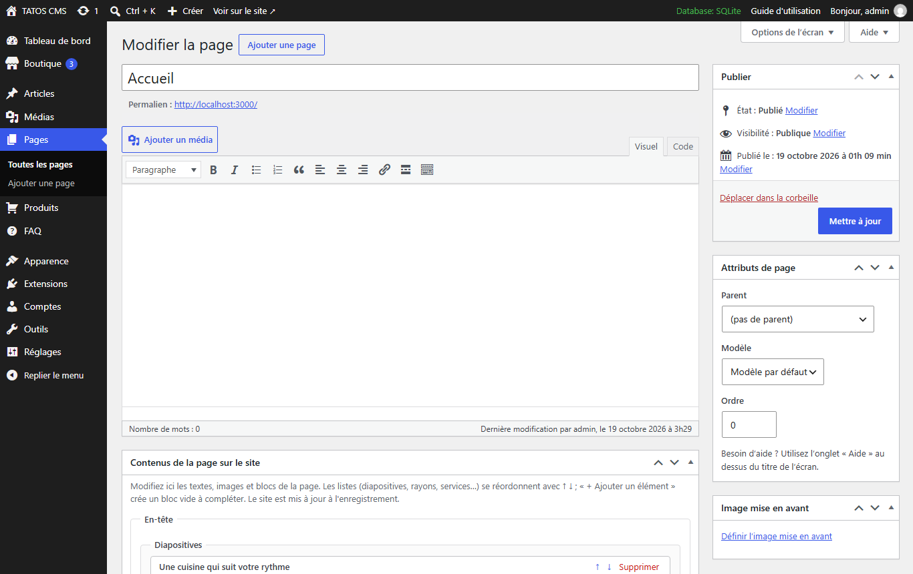
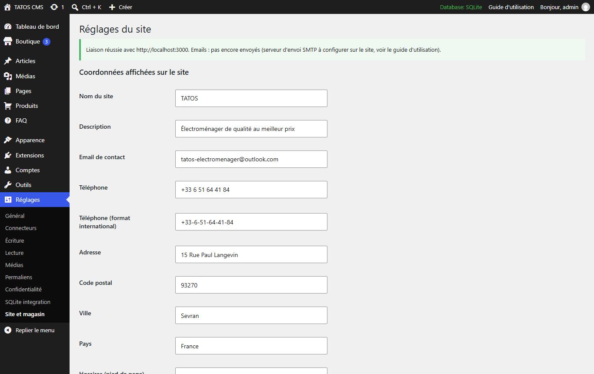
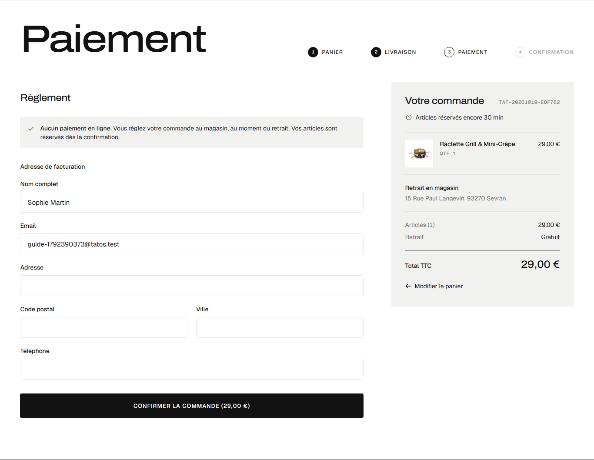

# Guide d'utilisation de la plateforme

Ce guide s'adresse à l'équipe du magasin. Il explique comment gérer toute la boutique en ligne depuis
l'administration WordPress : commandes, clients, stock, produits, pages, articles, promotions,
messages et réglages. Aucune connaissance technique n'est nécessaire.

> Ce guide est aussi consultable dans l'administration : menu **Boutique → Guide d'utilisation**, ou
> lien **Guide d'utilisation** en haut à droite de chaque écran.

## Comment la plateforme est organisée

La plateforme se compose de deux parties :

| Partie | Adresse | Rôle |
| --- | --- | --- |
| **Le site** (la boutique) | l'adresse publique de la boutique, par exemple `https://www.votre-boutique.fr` | Ce que voient les clients : catalogue, panier, commande, compte client. |
| **L'administration** (WordPress) | l'adresse de WordPress suivie de `/wp-admin`, par exemple `https://admin.votre-boutique.fr/wp-admin` | Là où l'équipe gère tout : contenus, catalogue, commandes, clients, messages. |

Tout ce que vous enregistrez dans l'administration est envoyé au site immédiatement : il n'y a rien à
« publier » ailleurs. Les commandes, les comptes clients et le stock réel sont conservés par le site ;
l'administration les affiche et les modifie à distance (menu **Boutique**).

## Se connecter

1. Ouvrez l'adresse de l'administration (`…/wp-admin`).
2. Saisissez votre identifiant (ou votre email) et votre mot de passe, puis **Se connecter**.
3. Mot de passe oublié : lien **Mot de passe oublié ?** sous le formulaire ; un lien de
   réinitialisation est envoyé à votre email.

Une fois connecté :

- le **menu de gauche** donne accès à toutes les rubriques (détaillées ci-dessous) ;
- en haut à gauche, **le nom du site** ouvre la boutique dans un **nouvel onglet** (l'administration
  reste ouverte) ;
- en haut à droite, **Guide d'utilisation** ouvre ce guide, et votre nom donne accès à votre profil
  et à la déconnexion.

Tous les liens marqués **↗** (« Voir sur le site ↗ », « Voir le site ↗ ») ouvrent la boutique dans un
nouvel onglet ; tous les autres liens restent dans l'administration.

### Les rubriques du menu

| Menu | Ce que l'on y fait |
| --- | --- |
| **Boutique** | Tableau de bord, commandes, clients, stock, codes promo, avis, messages, newsletter, guide. |
| **Articles** | Les articles de la rubrique « Conseils » du site. |
| **Médias** | Toutes les images (photos de produits, de pages, d'articles). |
| **Pages** | Les pages du site : accueil, services, à propos, contact, promotions, pages légales. |
| **Produits** | Le catalogue : fiches produits et catégories (rayons). |
| **FAQ** | Les questions fréquentes, classées par thème. |
| **Apparence → Menus** | Le menu principal du site et les liens légaux du pied de page. |
| **Comptes** | Les comptes de l'équipe (pas les clients : ceux-ci sont dans **Boutique → Clients**). |
| **Réglages → Site et magasin** | Coordonnées du magasin (adresse, téléphone, horaires, email) et liaison avec le site. |

## Comptes de l'équipe et rôles

Chaque personne de l'équipe doit avoir son propre compte : **Comptes → Ajouter un compte**, puis
choisissez son **rôle** :

| Rôle | Accès |
| --- | --- |
| **Administrateur** | Tout, y compris les réglages, les extensions et les comptes. À réserver au responsable. |
| **Gestionnaire de boutique** | Toute la rubrique **Boutique** (commandes, clients, stock, promotions, messages, newsletter), les produits, pages, articles, FAQ, médias et menus. Pas d'accès aux réglages techniques ni aux extensions. Rôle conseillé pour l'équipe du magasin. |
| **Éditeur** | Produits, pages, articles, FAQ et médias ; pas de rubrique Boutique. |
| **Auteur** | Rédige et publie ses propres articles. |

Bonnes pratiques : un mot de passe long et unique par personne, et suppression du compte d'une personne
qui quitte l'équipe (ses contenus peuvent être attribués à un autre compte lors de la suppression).

## Tableau de bord de la boutique

**Boutique → Tableau de bord** (également résumé sur l'accueil de l'administration) affiche :

| Indicateur | Signification (cliquez dessus pour la liste correspondante) |
| --- | --- |
| **Chiffre d'affaires (30 j)** | Total des commandes réglées sur les 30 derniers jours. |
| **À préparer / expédier** | Commandes confirmées qui ne sont pas encore parties (payées ou à régler à la livraison). |
| **Messages à traiter** | Nouveaux messages de contact, demandes de rendez-vous et signalements. |
| **Clients** | Nombre de comptes clients, et nouveaux comptes sur 30 jours. |
| **Stock faible** | Produits à 0 ou 1 exemplaire. |
| **Newsletter** | Nombre d'abonnés. |

Dessous : les dernières commandes, les produits en stock faible, la note moyenne des avis et des
raccourcis (ajouter un produit, écrire un article, modifier la page d'accueil, menus, coordonnées).
Une pastille rouge sur le menu **Boutique** indique le nombre de commandes et de messages à traiter.

## Commandes

**Boutique → Commandes** liste toutes les commandes confirmées, les plus récentes en premier. Les
onglets filtrent par statut (**À traiter** regroupe celles à préparer ou à expédier) ; la recherche
accepte un numéro de commande, un nom ou un email.

### Les statuts d'une commande

| Statut | Signification | Email au client |
| --- | --- | --- |
| **En attente de virement** | Commande confirmée par le client, articles réservés : vous attendez son virement. | Confirmation de commande avec la facture PDF et vos coordonnées bancaires. |
| **Payée** | Payée (virement reçu, ou carte en ligne), à préparer. | « Virement reçu » avec la facture acquittée (ou confirmation de commande pour la carte). |
| **En préparation** | En cours de préparation. | « Commande en préparation ». |
| **Expédiée** / **Prête à retirer** | Partie en livraison, ou prête au magasin pour un retrait. | « Commande en route » ou « Commande prête à retirer ». |
| **Livrée** / **Retirée** | Remise au client. | « Commande livrée » (invitation à laisser un avis). |
| **Annulée** | Annulée : les articles sont remis en stock automatiquement. | « Commande annulée ». |
| **Paiement refusé** | Le paiement par carte a échoué ; le client peut réessayer depuis son compte. | — |

Les commandes **en attente de paiement** (client parti avant de payer) n'apparaissent pas : leurs
articles sont réservés 30 minutes, puis remis en vente automatiquement.

### Deux façons de régler

- **Carte bancaire en ligne** (si le paiement Stripe est activé) : la commande arrive au statut
  **Payée**, la facture est disponible tout de suite.
- **Virement bancaire, avant livraison** : le client confirme sa commande et reçoit aussitôt par
  email la facture PDF avec vos coordonnées bancaires, le montant et la référence à indiquer (son
  numéro de commande). La commande arrive au statut **En attente de virement** avec le repère
  **virement attendu** dans la liste ; ses articles restent réservés.

### Traiter une commande

1. Cliquez sur le numéro de la commande : vous voyez les articles, le mode de livraison (distance,
   options, reprise de l'ancien appareil), l'adresse et le téléphone du client, l'adresse de
   facturation et l'historique des paiements.
2. Dans **Changer le statut**, choisissez le nouveau statut puis **Mettre à jour**. Laissez cochée
   la case **Prévenir le client par email** pour qu'il reçoive automatiquement le suivi.
3. Enchaînement habituel : **Payée (virement reçu)** → **En préparation** → **Expédiée** (ou
   **Prête à retirer**) → **Livrée** (ou **Retirée**).

### Enregistrer un virement reçu

Quand le virement arrive sur votre compte (vérifiez le montant et la référence de commande), ouvrez
la commande et choisissez **Payée (virement reçu)** puis **Mettre à jour**. Le paiement est
enregistré, la commande compte dans le chiffre d'affaires et le client reçoit sa facture acquittée.
Vous pouvez ensuite la préparer et la livrer : le site refuse de la passer en préparation ou en
livraison tant que le virement n'est pas marqué reçu. Sans virement, annulez-la pour remettre les
articles en vente. La carte **Virements attendus** du tableau de bord liste ces commandes.

### Annuler une commande ou rembourser

Choisissez **Annulée** puis **Mettre à jour** (une confirmation est demandée). Les articles sont
remis en stock. Une commande payée par carte se rembourse depuis votre espace Stripe
(<https://dashboard.stripe.com>) : l'annulation dans l'administration ne déplace pas d'argent.

### Facture

Le bouton **Ouvrir la facture PDF** apparaît dès que la commande est réglée. Le client retrouve la
même facture dans son espace client (**Mes commandes**).

## Clients

**Boutique → Clients** liste les comptes clients (recherche par nom ou email). La fiche d'un client
montre ses coordonnées, ses adresses de livraison et ses commandes (avec lien vers chacune).

Un client peut modifier lui-même son nom, ses adresses et son mot de passe, ou supprimer son compte
depuis son espace client. Lors d'une suppression, ses commandes et factures sont conservées (obligation
comptable) mais ses données personnelles sont effacées.

## Stock

**Boutique → Stock** affiche le stock réel de chaque produit. Corrigez une quantité dans la colonne
**Stock** puis **Enregistrer** sur la ligne. Le filtre **Stock faible** n'affiche que les produits à 0
ou 1 exemplaire.

Le stock baisse automatiquement à chaque commande et remonte à chaque annulation. Un produit à 0 n'est
plus proposé à la vente dans la boutique (sa fiche reste accessible par son adresse).

Le stock se modifie aussi depuis la fiche d'un produit (encadré **Stock et disponibilité**).

## Produits

**Produits** liste tout le catalogue ; la recherche, les filtres par catégorie et les colonnes
permettent de retrouver une fiche. **Voir sur le site ↗** ouvre la fiche publique dans un nouvel
onglet.

### Ajouter ou modifier un produit

**Produits → Ajouter un produit** (ou cliquez sur le nom d'un produit) :

1. **Titre** : le nom du produit, tel qu'il s'affiche sur le site.
2. **Texte principal** : la description.
3. **Catégories produit** (panneau de droite) : le rayon du produit (une seule catégorie).
4. **Fiche produit** (formulaire sous la description) :
   - **Identité** : marque, référence / modèle ;
   - **Prix** : prix TTC ; **prix promotionnel** TTC (laissez vide s'il n'y a pas de promotion — un
     prix promotionnel fait apparaître le produit dans les promotions) ;
   - **Caractéristiques** : dimensions, **poids** (utilisé pour les frais d'étage), niveau sonore,
     pose, couleurs, types (ex. hublot, top) ;
   - **Garantie** : durée en mois et descriptif ;
   - **Mise en avant** : **Produit vedette** (sélection de la page d'accueil), appareil connecté,
     exposé en magasin ;
   - **Images** : image principale, galerie et étiquette énergie (bouton **Choisir une image** pour
     prendre une image de la médiathèque ou en téléverser une nouvelle) ;
   - **Référencement (Google)** : titre et description pour les moteurs de recherche.
5. **Stock et disponibilité** (panneau de droite) : quantité en stock.
6. **Publier** (nouveau produit) ou **Mettre à jour**.

Le produit apparaît sur le site dans les secondes qui suivent. Pour retirer un produit de la vente sans
le supprimer, passez-le en **Brouillon** (panneau **Publier → État**) ou mettez son stock à 0.
**Corbeille** le supprime du site.

### Conseils pour les images

- Photos nettes sur fond blanc ou neutre, au format JPEG, PNG ou WebP, 1 200 pixels de large environ.
- Renseignez le **texte alternatif** de chaque image dans la médiathèque (description courte de ce
  que montre l'image) : il améliore l'accessibilité et le référencement.
- N'utilisez que des images dont vous avez les droits (vos propres photos, images du fabricant ou
  banques d'images libres de droit).

### Catégories (rayons)

**Produits → Catégories produit** : nom, **ordre d'affichage** (du plus petit au plus grand), **image**
(vignette du rayon) et **description courte**. Le lien **Voir sur le site ↗** ouvre la page du rayon.
Supprimer une catégorie ne supprime pas ses produits, mais ils doivent être rattachés à une autre
catégorie pour rester bien classés.

## Pages du site

**Pages** contient les pages de la boutique : **Accueil**, **Services**, **À propos de TATOS**,
**Nous contacter**, **Promotions**, **Modèle de page catégorie** (textes communs aux pages de rayon) et
les pages légales (**CGV**, **Mentions légales**, **Politique de confidentialité**).

### Pages à blocs (accueil, services, à propos, contact, promotions, catégorie)

Leur contenu se modifie dans le formulaire **Contenus de la page sur le site**, organisé par blocs (par exemple pour
l'accueil : carrousel, rayons, services, promotion, « Pourquoi nous choisir »…) :

- chaque champ correspond à un texte ou une image visible sur la page ;
- les listes (cartes, avantages, questions…) se complètent avec **Ajouter**, se réordonnent et se
  suppriment élément par élément ;
- les champs **Lien** attendent une adresse du site, par exemple `/boutique` ou `/contact` ;
- les champs **Image** ont un bouton **Choisir une image** (médiathèque) ;
- **Description de l'image** : texte lu par les lecteurs d'écran, à remplir pour chaque image.

L'encadré **Référencement (Google)** permet de définir le titre et la description de la page pour Google.
Cliquez sur **Mettre à jour** : la page du site est actualisée immédiatement.

### Pages légales

Les CGV, mentions légales et politique de confidentialité se rédigent dans l'éditeur de texte : chaque
**titre de niveau 2** devient une section de la page. Vérifiez et complétez ces pages avec les
informations réelles de votre entreprise (raison sociale, SIRET, hébergeur, médiateur de la
consommation…) avant la mise en ligne : les passages entre crochets, comme `[Nom du service de
médiation]`, sont à remplacer.

## Articles (rubrique « Conseils »)

**Articles → Ajouter un article** ouvre l'éditeur de blocs :

1. Saisissez le titre, puis rédigez le texte (paragraphes, intertitres, listes, images).
2. Dans le panneau de droite : **Catégorie** (thème de l'article), **Image mise en avant** (photo en
   tête de l'article et dans la liste des conseils) et **Extrait** (résumé affiché dans la liste).
3. **Publier**. L'article apparaît dans la rubrique « Conseils » du site.

**Articles → Catégories** gère les thèmes des articles.

## FAQ

**FAQ** liste les questions. Pour en ajouter une : **FAQ → Ajouter**, la question en titre, la réponse
dans le texte, le thème dans **Catégories FAQ**, puis **Publier**. L'**ordre** (panneau **Attributs**)
classe les questions dans leur thème ; l'ordre des thèmes se règle dans **FAQ → Catégories FAQ**.

## Menus du site

**Apparence → Menus** :

- **Menu principal (en-tête)** : les rubriques de la barre de navigation du site ;
- **Liens légaux (pied de page)** : les liens en bas de chaque page.

Ajoutez des pages, des liens personnalisés (adresse du site, par exemple `/promotions`) ou des
catégories, glissez-déposez pour réordonner, puis **Enregistrer le menu**.

## Codes promo

**Boutique → Codes promo** liste les codes existants (réduction, nombre d'utilisations, conditions,
état). Pour créer un code, remplissez le formulaire :

| Champ | Utilisation |
| --- | --- |
| **Code** | Ce que le client saisit dans son panier (ex. `ETE2026`). |
| **Description (interne)** | Note pour l'équipe, non visible des clients. |
| **Type** et **Valeur** | Pourcentage (ex. 10 %) ou montant fixe en euros. |
| **Commande minimum** | Montant minimum du panier pour utiliser le code. |
| **Nombre d'utilisations maximum** | Vide = illimité. |
| **Date de fin** | Dernier jour de validité (inclus). |

Un code peut être modifié, désactivé (il reste dans l'historique) ou supprimé. Le code de bienvenue et
les codes de fidélité personnels des clients apparaissent aussi dans cette liste.

## Avis clients

**Boutique → Avis clients** liste les avis (note, commentaire, produit, client). Seuls les clients
ayant acheté un produit peuvent le noter, une fois par produit. Supprimez un avis abusif ou hors sujet
avec **Supprimer** ; la note moyenne du produit est recalculée.

## Messages

**Boutique → Messages** regroupe trois boîtes, en onglets :

- **Contact** : messages envoyés depuis la page Contact ;
- **Rendez-vous** : demandes de devis ou de rendez-vous depuis la page Services ;
- **Signalements** : problèmes signalés depuis la page « Signaler un problème » (avec captures).

Pour chaque message : changez son **statut** (Nouveau, En cours, Traité…) et **répondez** directement
au client : déroulez **Répondre**, écrivez votre réponse, puis envoyez. Le client la reçoit par email,
et peut vous répondre par simple retour d'email.

## Newsletter

**Boutique → Newsletter** liste les abonnés (recherche, retrait d'un abonné, **export CSV**).

Pour envoyer une lettre :

1. Saisissez l'**objet** et le **message** (texte simple ; les adresses web deviennent des liens).
2. Vérifiez le rendu avec **M'envoyer un aperçu** (envoyé à l'adresse indiquée).
3. Cliquez sur **Envoyer à tous les abonnés** (une confirmation est demandée).

Un lien de désinscription est ajouté automatiquement à chaque lettre.

## Médias

**Médias** contient toutes les images. **Ajouter un fichier média** pour téléverser ; cliquez sur une
image pour modifier son **texte alternatif**, son titre, la recadrer ou la supprimer. Évitez de
supprimer une image encore utilisée par un produit ou une page.

## Coordonnées du magasin et liaison avec le site

**Réglages → Site et magasin** (administrateurs) :

- **Coordonnées affichées sur le site** : nom, description, email, téléphone, adresse, horaires,
  adresse pour la carte. Elles apparaissent dans l'en-tête, le pied de page, la page contact, les
  emails et les factures.
- **Paiement par virement** : titulaire du compte, banque, IBAN et BIC. Ils sont imprimés sur la
  facture envoyée au client à chaque commande et affichés sur sa page de confirmation. Tant que
  l'IBAN est vide, le client est prévenu que vos coordonnées lui seront envoyées par email, et
  l'alerte « nouvelle commande » vous le rappelle.
- **Liaison avec le site (technique)** : adresse publique du site et clé d'administration (l'adresse
  et le secret du webhook sont facultatifs : par défaut, ces deux valeurs suffisent). Ces valeurs sont
  fournies lors de l'installation ; ne les modifiez pas sans votre prestataire.
- **Vérifier la liaison avec le site** : contrôle que l'administration communique bien avec le site,
  que la **mise à jour instantanée** est active (chaque modification enregistrée apparaît sur le site
  en quelques secondes) et que l'envoi des emails est actif.

## Ce que voient vos clients

Connaître le parcours client aide à répondre à leurs questions.

1. **Catalogue** : recherche, rayons, filtres (catégorie, type, prix, promotions), fiches produit
   (photos, caractéristiques, garantie, étiquette énergie, avis).
2. **Panier** : quantités, code promo, puis **retrait en magasin** (gratuit) ou **livraison à
   domicile**. Pour la livraison, l'adresse est vérifiée et la distance calculée depuis le magasin :
   livraison jusqu'à 80 km, au pied du camion, dans la pièce de son choix ou avec installation, frais
   d'étage au-delà du 3e étage sans ascenseur, reprise possible de l'ancien appareil. Acceptation des
   CGV obligatoire.
3. **Coordonnées** : au moment de payer, le client commande **sans compte** avec son seul email (ou se
   connecte s'il a déjà un compte).
4. **Règlement** : par virement bancaire avant livraison (ou par carte si Stripe est activé). Les
   articles sont réservés 30 minutes le temps de confirmer, puis jusqu'au virement.
5. **Confirmation** : page de confirmation avec le montant, la référence et vos coordonnées
   bancaires, et email mis en forme avec la **facture et le devis PDF** joints.
6. **Compte** : l'email et la page de confirmation invitent le client à créer son compte en choisissant
   son mot de passe (lien personnel valable 7 jours) ; il y retrouve ses commandes et ses factures.
7. **Espace client** (« Mon compte ») : tableau de bord, **Mes commandes** (suivi, factures,
   annulation d'une commande non réglée), adresses de livraison, **Mon profil** (coordonnées, mot de
   passe, suppression du compte), codes de fidélité.
8. **Après la livraison** : le client peut noter les appareils achetés.

## Emails envoyés automatiquement

| Événement | Destinataire |
| --- | --- |
| Création de compte | Client (bienvenue) |
| Commande confirmée (payée, ou en attente de virement) | Client (récapitulatif, facture PDF jointe avec vos coordonnées bancaires) et magasin (alerte « nouvelle commande ») |
| Virement marqué reçu | Client (facture acquittée jointe) |
| Changement de statut (si « Prévenir le client » est coché) | Client |
| Mot de passe oublié | Client (lien valable 1 heure) |
| Message de contact, demande de rendez-vous, signalement | Magasin (avec réponse directe possible) et accusé de réception au client |
| Réponse depuis **Boutique → Messages** | Client |
| Inscription à la newsletter, lettre envoyée | Abonné (avec lien de désinscription) |

Les emails partent de la boîte du magasin (contacts@destocktatos.com), aux couleurs du site ; les
alertes du magasin y arrivent aussi. Si **Vérifier la liaison** indique que les emails ne sont pas
envoyés, contactez votre prestataire : les messages sont conservés sur le serveur et pourront être
renvoyés.

## Questions fréquentes

**Ma modification n'apparaît pas sur le site.**
Rechargez la page du site (touche F5) : les modifications apparaissent en quelques secondes. Si rien ne
change, utilisez **Réglages → Site et magasin → Vérifier la liaison avec le site** : la ligne « Mise à
jour instantanée » indique ce qui bloque.

**La rubrique Boutique affiche « Le site ne répond pas ».**
Le site est momentanément injoignable ou la liaison est mal configurée : vérifiez la liaison (voir
ci-dessus) puis contactez votre prestataire si le problème persiste.

**Un client n'a pas reçu son email.**
Demandez-lui de vérifier ses courriers indésirables. Vérifiez ensuite que l'envoi des emails est actif
(**Vérifier la liaison avec le site**).

**Un client veut annuler une commande.**
S'il n'a pas encore réglé en ligne, il peut l'annuler lui-même depuis **Mes commandes**. Sinon,
passez la commande à **Annulée** ; si elle a été payée par carte, remboursez-la depuis Stripe.

**Comment mettre un produit en promotion ?**
Renseignez son **prix promotionnel** dans sa fiche. Pour une réduction sur tout le panier, créez un
**code promo**.

**Comment changer les tarifs de livraison ?**
La grille de livraison (par distance) est définie par le site ; demandez la modification à votre
prestataire (voir la documentation technique, « Architecture »).

**J'ai supprimé un contenu par erreur.**
Les produits, pages et articles supprimés restent 30 jours dans la **Corbeille** de leur rubrique :
**Restaurer** les remet en place.

## Bonnes pratiques

- Traitez les commandes **À traiter** et les **messages** chaque jour (pastille rouge du menu
  Boutique).
- Tenez le **stock** à jour pour ne pas vendre un appareil indisponible.
- Remplissez toujours le texte alternatif des images et les champs de référencement des nouvelles
  pages et produits.
- Ne partagez jamais vos identifiants ; créez un compte par personne.
- Avant une modification importante d'une page, notez ou copiez son contenu : WordPress garde aussi
  l'historique des **révisions** des articles.
